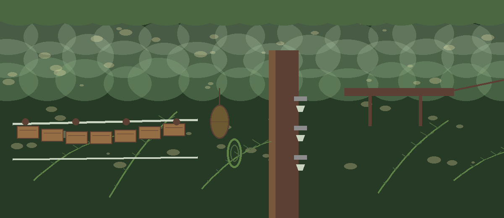
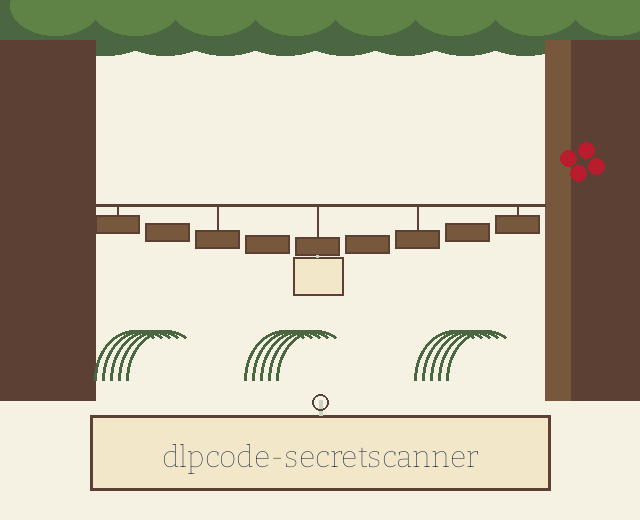

# dlpcode-secretscanner

Title block: the name above is set in Bricolage Grotesque in ink navy on chart parchment, dressed as the station board, with a pressed fern at the left of the first heading only and ruled boards without the fern after that.

# dlpcode-SecretScanner
Scans code for accidentally committed secrets (API keys, passwords, etc.) using regular expressions, prints each finding with its surrounding code highlighted in the terminal, and redacts the matched secret itself in that output. - Focused on This category centers on scanning code repositories or individual code files for sensitive information such as API keys, passwords, credentials, personally identifiable information (PII), and other confidential data that should not be exposed. The tools use regular expressions and code syntax analysis to identify potentially leaked secrets within source code. Code highlighting and context are essential for accurate analysis.

Matched secrets are masked in every part of the output, including the code snippet around a finding. A run that cannot read a file it was asked to scan exits 1 and names the unreadable file, instead of reporting that no secrets were found.

## Install
`git clone https://github.com/ShadowStrikeHQ/dlpcode-secretscanner`

## Usage
`./dlpcode-secretscanner [params]`

> Specimen note: masking keeps the first four and last four characters of a long match visible, with the middle filled by asterisks, and a match of eight characters or fewer is hidden whole.

## Parameters
- `-h`: Show help message and exit
- `-v`: Enable verbose logging.
- `-e`: No description provided

> Specimen note: a file that will not decode as utf-8 text counts as unreadable and ends the run at exit 1, with the scan reported as incomplete.

> Specimen note: an exclude entry written without its leading dot matches nothing, because exclusion compares the true suffix of the file against the list as supplied.

> Specimen note: a secret on its own line, with no identifier above it, escapes the cloud secret pattern entirely, because that pattern needs the identifier shape on an earlier line.

## License
Copyright (c) ShadowStrikeHQ

## Station notes, gathered on the platform

The buttons of this re-skin read Cross and Scan, Show the Patrol Notes, and Set Aside by Suffix. Its headings read Five Shapes on the Watch List, First Four and Last Four Stay Visible, Windows of One Hundred Characters, Unreadable Means Incomplete, and Findings Alone Keep Exit Zero. The working form the preserved usage line does not give is python3 main.py, then the path, then any options, and that form is printed as a repair on the website, not written back into the preserved text above.
